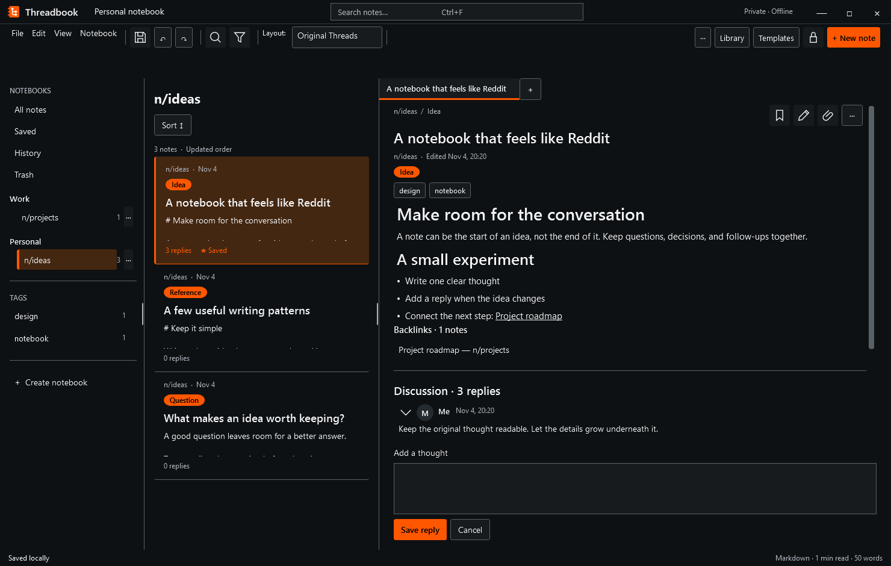

<p align="center"></p>

# Threadbook

Your notes deserve room for a conversation. Threadbook is an offline Windows notebook that combines Markdown notes, nested replies, local note links, and six views of the same library.



## Start writing

1. Open [Releases](https://github.com/SeanShaffer88/Threadbook/releases) and look for the beta.2 `Threadbook-v0.2.0-beta.2-win-x64-setup.exe` or `Threadbook-v0.2.0-beta.2-win-x64-portable.zip`. Check availability and SHA-256 checksums on the corresponding release page.
2. Install the **.NET 10 Desktop Runtime for Windows x64** from [Microsoft](https://dotnet.microsoft.com/en-us/download/dotnet/10.0). It includes the core .NET Runtime; you do not need a separate core runtime or the SDK to run Threadbook.
3. Run the per-user setup, or extract the complete portable ZIP into a writable folder and open `Threadbook.exe`. Keep the companion files together.
4. Choose **+ Create notebook**, then **New note**. Write a title and Markdown body, save, and add a reply.

This is beta software. Both packages depend on the Desktop Runtime. Keep independent backups of important notes. There is no automatic updater. Availability and qualification limits are listed on the release page; see [packaging](docs/packaging.md).

## Write, connect, and revisit

- **Edit where you read.** Select a note and use its pencil action to edit inline. The writer includes formatting, Source/Preview, outline, find/replace, tables, undo/redo, and explicit Save. The note menu also offers **Open advanced editor…** for the separate writer.

- **Use a note as a prompt.** Write fill-in blanks as `{{name}}` or `{{name = default}}`, then choose **Run prompt…** in the writer to fill each blank in a sheet with a live preview and copy the finished prompt — nothing is saved or sent. Type `/` at the start of a word in the writer to insert prompt parts (Role, Task, Context, Steps, Constraints, Output format, and more) from the slash menu. Prefix a blank with a backslash (`\{{name}}`) to keep it as literal text.
- **Find your next action.** Press **Ctrl+Shift+P** in the main window, or choose **View → Command palette**. Search available commands, notes, and notebooks, then select an entry. Locked or unavailable actions stay guarded.
- **Make the panes fit.** Drag a visible vertical grip, or focus it and press Left/Right to resize in small keyboard steps of 16 logical pixels. Escape cancels a drag. Widths persist separately for each layout and adapt to the available space; compact navigation hides grips.
- **Recover earlier work.** Open **History** or **Trash** from the left navigation or View menu. Select a note before opening History. Preview an entry before restoring it. Version restore keeps current replies and library metadata and first archives the current note. Trash restores complete deleted notes or notebook cascades, including replies, tags, tasks, and attachment files.
- **Connect local notes.** Write `[[Project roadmap]]` in Markdown, or choose **Insert note link** in the writer to select a note and insert a stable ID link. Title links can become ambiguous after duplicate titles appear; the chooser asks you to select the intended note. Missing targets show a broken-link state and do not create notes. Backlinks list notes in your library that link to the selected note. Stable links survive renaming; title links resolve against the current library.

History retains up to **20 versions per note**, **5,000 archive entries**, and **512 MiB** total. Nothing is purged automatically: at capacity, export what you need and explicitly remove selected entries. If a multi-step write only partly completes, follow the warning and use **Retry completion** or **Cancel prepared operation** in History/Trash before continuing. File replacements are not a multi-file atomic transaction.

## Organize your library

Use **Notebook → Manage notebooks**, **Library**, and **Templates** to organize notebooks, nested folders, tags, and reusable note templates. Full-text search covers titles, bodies, flair, replies, and attachment names. Search filters include notebook, all selected tags, UTC dates, saved notes, attachments, and tasks.

Track managed tasks with due times, completion, and snooze, or toggle Markdown checklists. Reminders run while Threadbook is open and pause while locked. Attach local files to saved notes; bounded PNG/JPEG previews stay local, while other files remain opaque and are never executed. Markdown tables render in Preview. Images are attachment previews rather than remote Markdown image downloads.

Choose Light, Dark, or System theme and a layout:

| Layout | What you see |
| --- | --- |
| Original Threads | Notebooks, note feed, and conversation in three columns |
| Kanban Flow | Inbox, In progress, and Archived presentation lanes |
| Mind Map Central | Notebook → note → nested reply relationships |
| Magazine Minimal | A quieter reading feed |
| Focus Editor | The selected note with fewer distractions |
| Workspace Tabs | Up to 12 notebook or note contexts |

All layouts share the same data. Kanban lanes do not change note content or saved status. Layout preferences, pane widths, and tab contexts persist separately from your notes.

## Save, import, and export

Save explicitly commits a note. Draft recovery retains one draft after a short debounce and on close. Resolve an existing kept recovery draft before starting another editing context; review, export, or discard it explicitly. Recovery warns about changed saved revisions instead of silently overwriting them.

Export saved notes as Markdown or passive HTML, or export the current draft separately. Notebook JSON supports transfer; JSON import creates fresh identities and preserves reply relationships. Markdown/text file and folder imports append to a selected notebook after validation. Imports do not replace existing notes by title. Portable backup restore validates into a **new directory**, without merging into the open library.

## Storage and privacy

Your installed/default library is `%LOCALAPPDATA%\Threadbook`. The portable ZIP has `portable.flag` beside the executable and stores its library in adjacent `Data`, independent of the working directory. Portable storage errors fail visibly without falling back. To choose another directory, launch `Threadbook.exe --data-dir` followed by that directory's path. Only one running process can own a library directory.

Ordinary libraries store **plaintext JSON**. Password protection creates a verified encrypted copy in a **new directory**. The original plaintext notes, backups, and preserved files remain unchanged on disk. Protect those copies too.

Encrypted libraries use AES-256-GCM per file and PBKDF2-SHA256 with 600,000 iterations. File names remain visible. Lock hides owned content windows and wipes the owned session key; it cannot guarantee complete erasure of managed content or password copies from memory. There is no password recovery. Encryption at rest cannot protect an already compromised running session.

Threadbook works offline with no sync, telemetry, cloud account, or background reminder service. Preview does not open external destinations or load remote images; local wiki links navigate within the library. Protected-library plaintext exports require explicit consent. Backups, history, trash, and preserved damaged files can retain earlier or deleted content.

The existing Snapshot, Library, and Recovery schema versions remain 1; new optional sidecars store archive and UI state. Do not manually remove sidecars from a live library.

## Keyboard shortcuts

| Context | Keys | Action |
| --- | --- | --- |
| Main window | Ctrl+Shift+P | Open command palette |
| Main window | Ctrl+F | Focus library search |
| Main window / writer | Ctrl+N | Start a new note through draft safeguards |
| Writer | Ctrl+S | Save |
| Writer | Ctrl+B / Ctrl+I / Ctrl+K | Bold / italic / Markdown link |
| Writer | Ctrl+F | Literal find/replace |
| Writer | Ctrl+Z / Ctrl+Y | Undo / redo |
| Focused reply | Ctrl+Enter | Save reply |
| Focused pane grip | Left / Right; Escape | Resize; cancel active drag |

## Build and verify

Use Windows, PowerShell 7, and **.NET SDK 10.0.403** with Windows desktop targeting support. The local verification runtime was **10.0.14**. From the repository root:

```powershell
dotnet build desktop/Threadbook.Desktop.csproj -c Release --warnaserror
if ($LASTEXITCODE -ne 0) { throw "Desktop build failed: $LASTEXITCODE" }
```

See [VERIFICATION.md](VERIFICATION.md) for isolated test commands, recorded local results, and verification limits. Consult [GitHub Actions](https://github.com/SeanShaffer88/Threadbook/actions) for hosted CI results; each release records its own artifact checks. The repository clears NuGet package sources and uses framework references rather than external package dependencies.

Core provides reusable domain logic, Storage depends on Core, and Desktop composes both. Start with the [Core](core/README.md) and [Storage](storage/README.md) contracts for module use. See [CHANGELOG.md](CHANGELOG.md) for the beta changes.

## Scope and license

Notes allow 100,000 body characters; reply nesting is limited to 16 levels. Attachments allow 25 MiB each and 512 MiB total. Preview and local link indexing have bounded render/work budgets; notices report truncation or incomplete results, while source remains available. OCR, audio recording, handwriting, web clipping, and a terminal are outside the current scope.

The original source and orange threaded-book artwork use the [MIT license](LICENSE). [Ferrite](https://github.com/OlaProeis/Ferrite) inspired feature exploration and visual design. No Ferrite code or artwork is included, and no feature parity is claimed. The hero shows original synthetic notes in the actual WPF app, not personal notes or a published beta binary.
